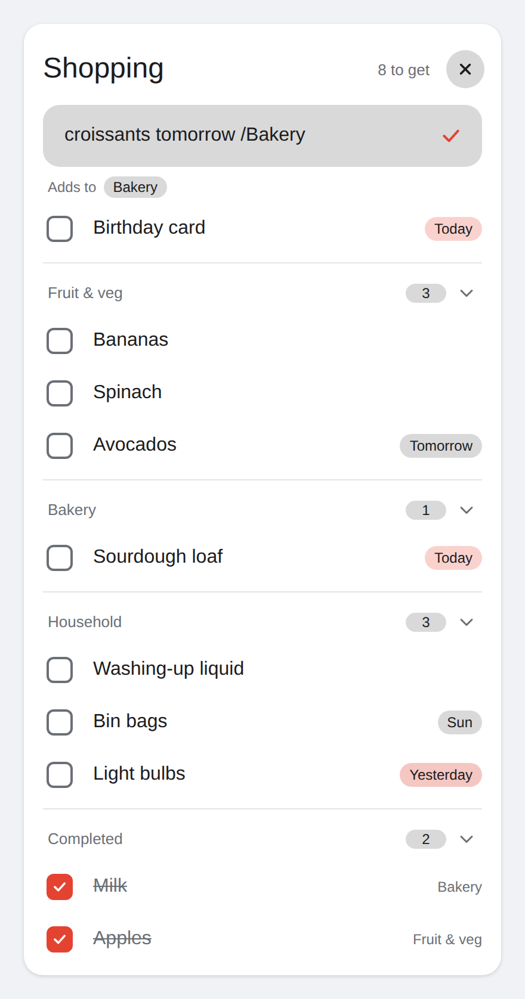

# Natural Language To-do Card

[](https://my.home-assistant.io/redirect/hacs_repository/?owner=joshmd&repository=natural-language-todo&category=plugin)
[](https://hacs.xyz)
[](https://github.com/joshmd/natural-language-todo/actions/workflows/validate.yml)
[](https://www.buymeacoffee.com/joshmd)

A Home Assistant dashboard card for your to-do lists that:

- adds items the way you'd say them: `milk tomorrow 5pm /Bakery`
- groups items into **sections** you can collapse or hide
- sorts by **due date**, and can stay compact on busy dashboards
- keeps the add bar tucked away until you need it
- can show recently **completed** items
- is set up in a **visual editor**, with no YAML needed

It works with **any Home Assistant to-do list**: Local To-do, Todoist, Google Tasks, CalDAV, the Shopping list and others.



## Choose your setup

| Setup | What you need | Sections | Understands |
|---|---|---|---|
| **[1. Any to-do list](#setup-1-any-to-do-list)** | Just this card | Show several lists in one card, one section each | Dates and times, if the list supports them |
| **[2. Todoist, with your existing integration](#setup-2-todoist-with-your-existing-integration)** | This card and the core [Todoist integration](https://www.home-assistant.io/integrations/todoist/) | Add into a Todoist section with `/Section`. Items are not grouped by section | Dates, times, repeats (`every 2 months`), `@labels`, `p1`–`p4` |
| **[3. Todoist with sections](#setup-3-todoist-with-sections)** | This card and the [companion integration](https://github.com/joshmd/natural-language-todo-companion), set up in the UI | Real Todoist sections, grouped | Todoist's own Quick Add parser |

None of these need YAML. Setups 1 and 2 use Home Assistant's own to-do lists and actions, with no token. Setup 3 asks for a Todoist API token once, in the companion's setup screen.

Already using the YAML **Todoist bridge** from version 0.1? It still works. See [moving to the companion](docs/todoist-bridge.md#moving-to-the-companion-integration).

## Requirements

- Home Assistant **2024.8** or newer (setup 3: **2026.1** or newer)
- [HACS](https://hacs.xyz), unless you install manually

---

## Install the card

1. Open **HACS** in Home Assistant and search for **Natural Language To-do Card**, or click this button:

   [](https://my.home-assistant.io/redirect/hacs_repository/?owner=joshmd&repository=natural-language-todo&category=plugin)

2. Select **Download**, then **Download** again to confirm.
3. When HACS asks, reload your browser.

HACS registers the dashboard resource for you.

<details>
<summary>Install the card manually instead</summary>

1. Download `natural-language-todo-card.js` from the [latest release](https://github.com/joshmd/natural-language-todo/releases/latest).
2. Copy it to `/config/www/natural-language-todo-card.js`.
3. Go to **Settings** → **Dashboards** → three-dot menu → **Resources** → **Add resource**:
   - URL: `/local/natural-language-todo-card.js?v=0.4.0`
   - Resource type: **JavaScript module**
4. Reload your browser. Change the `?v=` number whenever you update the file, or browsers keep using the old copy.

If you don't see **Resources**, turn on **Advanced mode** in your user profile.

</details>

---

## Setup 1: Any to-do list

1. Edit a dashboard and select **Add card**.
2. Search for **Natural Language To-do Card**. It starts with your first to-do list, sorted by due date.
3. Use the editor to pick your lists and options. In YAML it looks like this:

```yaml
type: custom:natural-language-todo-card
entity: todo.shopping_list
title: Shopping
```

Don't have a list yet? Add the **Local To-do** integration in **Settings → Devices & services** to create one.

### Several lists as sections

List more than one to-do list and each becomes a section of the card. Type `/` and a list's name to add to that list. Without one, items go to the first list.

```yaml
type: custom:natural-language-todo-card
title: Shopping
entities:
  - todo.fruit_and_veg
  - todo.bakery
  - entity: todo.household
    name: Around the house   # optional: rename the section
```

`bread tomorrow /Bakery` adds "bread" to the Bakery list, due tomorrow.

### What the card understands

The card works dates out itself, and only when the list can store them. A list without due dates keeps what you typed as it is. The preview under the box shows exactly what will be saved before you press Enter.

| You type | Due |
|---|---|
| `today`, `tonight`, `tomorrow` | That day |
| `friday`, `on monday` | The next one (today, if it's that day) |
| `next friday`, `next week` | Friday or Monday of next week |
| `weekend` | The coming Saturday |
| `in 3 days`, `in two weeks`, `in a month` | That far ahead |
| `25 dec`, `December 25th`, `3 march 2027`, `2026-12-25` | That date. Past dates without a year mean next year |
| `25/12` | Day/month or month/day, following your Home Assistant date format |
| `5pm`, `5:30pm`, `17:45`, `at noon` | That time, if the list supports times. A time on its own means today, or tomorrow if it has passed |

To avoid mistakes:

- **Short day names only count at the end:** `bin bags fri` is due Friday, but `sun cream` and `sat nav` stay as they are. The same goes for `25/12`, so `flour 1/2 kg` is left alone.
- **Quotes switch parsing off:** `"back to the future" friday` adds "back to the future", due Friday.
- **Repeats aren't supported** in Home Assistant's own lists. `every monday` stays in the text, and the preview says so. Use setup 2 or 3 with Todoist for repeating items.

The words are English. Date and time display follows your Home Assistant language.

---

## Setup 2: Todoist, with your existing integration

If you already use the core [Todoist integration](https://www.home-assistant.io/integrations/todoist/), each Todoist project is already a to-do list in Home Assistant. Point the card at one:

```yaml
type: custom:natural-language-todo-card
entity: todo.weekly_food_shop
title: Food shop
```

The card spots that the list comes from Todoist and adds items through the integration's `todoist.new_task` action, so **Todoist parses the date**. On top of everything in setup 1, you can use:

| You type | Result |
|---|---|
| `/Bakery` | Adds to the Bakery section. For a name with spaces, use quotes: `/"Corner shop"` |
| `every 2 months`, `every monday`, `daily` | A repeating task |
| `@home` | Adds the label "home" |
| `p1` to `p4` | Priority, as in the Todoist app |

Things to know:

- **Sections aren't shown as groups.** The Todoist integration doesn't tell Home Assistant which section a task is in, so the list shows ungrouped. For grouped sections, use [setup 3](#setup-3-todoist-with-sections).
- **The card can't check section names.** The preview marks them "checked by Todoist". If the section doesn't exist, Todoist rejects the item, the card shows the error and your text is kept.
- **New items take a moment to show up.** The card shows them straight away, and the Todoist integration confirms them on its next refresh.
- **Completed items aren't available.** The Todoist integration only provides open tasks.
- **Renamed lists:** the card finds the Todoist project by the list's name. If you've renamed the list in Home Assistant, set `todoist_project:` to the project's name in Todoist.

---

## Setup 3: Todoist with sections

The [Natural Language To-do Companion](https://github.com/joshmd/natural-language-todo-companion) is a small integration that syncs the Todoist projects you choose, with their sections, and adds tasks with Todoist's own Quick Add parser.

1. Install the companion from HACS:

   [](https://my.home-assistant.io/redirect/hacs_repository/?owner=joshmd&repository=natural-language-todo-companion&category=integration)

2. Restart Home Assistant.
3. Go to **Settings → Devices & services → Add integration**, search for **Natural Language To-do Companion**, paste your Todoist API token (Todoist → **Settings → Integrations → Developer**), and tick your projects.
4. Add the card. In its editor, choose **Todoist, with sections**, then pick a project.

```yaml
type: custom:natural-language-todo-card
source: companion
project_id: 6Jf8VQXxpwv59GRH
title: Shopping
sort: due
```

Type `/` and a section's name to add to that section: `croissants tomorrow /Bakery`. Multi-word names work, and the preview shows the section before you save. Everything else is parsed by Todoist: dates, repeats, `@labels` and `p1`–`p4`.

If the companion isn't installed, the card says so and links to it.

**Already using the card with `entity: todo.…` (setup 2)?** Installing the companion doesn't change those cards: they still read the to-do entity, which has no sections. The card shows a tip until you switch it. Open the card's editor and choose **Todoist, with sections**, or change the YAML:

```yaml
# Before: setup 2, no sections
type: custom:natural-language-todo-card
entity: todo.weekly_food_shop
```

```yaml
# After: setup 3, with sections
type: custom:natural-language-todo-card
source: companion
project_id: 6Jf8VQXxpwv59GRH
```

The project ID is the code at the end of the project's web address in Todoist (`…/project/weekly-food-shop-6Jf8VQXxpwv59GRH`). The editor picks it for you.

Tasks show their **subtasks** indented underneath, and their **priority** (P1 to P3) and **@labels** as small tags. Turn the tags off with `show_labels: false` or `show_priority: false`.

### Several projects in one card

Pick more than one project in the editor, or list them:

```yaml
type: custom:natural-language-todo-card
source: companion
projects:
  - 6Jf8VQXxpwv59GRH
  - id: 6Crfh62CHW6r9wc5
    name: Joint            # optional: rename the heading
layout: nested             # or flat
default_project: 6Jf8VQXxpwv59GRH   # optional: where items go with no "/"
```

- **Nested** (default): each project is a collapsible heading, with its sections inside.
- **Flat:** sections with the same name are merged across projects, and each item shows its project.

Typing `/` works across all the projects in the card:

| You type | Goes to |
|---|---|
| no `/` | The default project (the first, unless you set `default_project`) |
| `/Joint Inbox` | That project, with no section |
| `/Bakery` | The project that has a Bakery section. If several do, the default project's, or if it has none, the card asks you to be specific |
| `/Weekly Food Shop/Bakery` | Exactly that project and section |

The preview shows the full destination before you save. If one project can't be loaded, the card shows a note for it and still shows the others. `hide_sections` and `collapsed_sections` accept a section name (every project), `Project/Section` (one project) or a project name.

---

## Card size

| Dashboard | How to keep the card compact |
|---|---|
| **Sections** (the default for new dashboards) | Open the card's **Layout** tab and set its width and height. The header and add bar stay put, and the list scrolls inside the card. |
| **Any** | Set **Show at most this many items** (`max_items`). The card shows that many, in order, then a **Show 12 more** button. The count in the header stays the full total. |
| **Any** | Set a **maximum list height** (`max_height`, for example `400px`). The list scrolls inside the card. |

## Options

Most options can be set in the visual editor. These are YAML only: `hide_sections`, `collapsed_sections`, `completed_collapsed`, `show_unsectioned`, `unsectioned_title`, `todoist_project`, custom list and project `name:`s, and the bridge options. The editor keeps them when you change other settings.

| Option | Default | Description |
|---|---|---|
| `entity` | | The to-do list to show (setups 1 and 2) |
| `entities` | | Several lists, one section each. Each entry is an entity ID, or `entity:` plus an optional `name:` |
| `project_id` | | Setup 3: the Todoist project |
| `projects` | | Setup 3: several Todoist projects in one card. Each entry is a project ID, or `id:` plus an optional `name:` |
| `layout` | `nested` | With several projects: `nested` (projects as headings) or `flat` (sections merged by name) |
| `default_project` | first project | With several projects: where items go when you don't type `/` |
| `show_labels` | `true` | Setup 3: show a task's @labels as tags |
| `show_priority` | `true` | Setup 3: show a task's priority (P1 to P3) as a tag |
| `title` | none | Card heading |
| `sort` | `manual` | `due` (overdue first, then by date and time, undated last), `alphabetical`, or `manual` (the list's own order). Sorting applies within each section. New cards from the picker start with `due` |
| `max_items` | `0` | Show at most this many open items, then a **Show more** button. `0` shows everything |
| `max_height` | none | Maximum height of the list, such as `400px`, `30em` or `50vh`. The list scrolls inside the card |
| `show_completed` | `false` | Show a Completed group, if the list keeps completed items |
| `completed_limit` | `10` | Maximum completed items shown |
| `completed_collapsed` | `true` | Completed group starts collapsed |
| `hide_sections` | `[]` | Sections to hide, by name or ID. Their items are hidden too |
| `collapsed_sections` | `[]` | Sections collapsed until someone expands them |
| `hide_empty_sections` | `true` | Hide sections with no open items |
| `show_unsectioned` | `true` | Show items that are not in a section |
| `unsectioned_title` | none | Give unsectioned items a header. Without one, they sit at the top |
| `due_display` | `all` | `all`, `soon` (overdue, today, tomorrow) or `none` |
| `parse_dates` | `true` | Set to `false` to keep everything you type as the item text |
| `todoist_project` | list name | Setup 2 only: the Todoist project name, if it differs from the list's name |
| `add_timeout` | `20` | Seconds of no typing before the add bar closes. `0` = never |
| `show_count` | `true` | Show the open-item count in the header |
| `count_suffix` | `open` | Text after the count, for example `to get` |
| `show_hint` | `true` | Show the example under the add field |
| `accent` | theme accent | Any CSS colour for the + button, ticks and today chips |
| `source` | `auto` | `todo`, `companion` or `todoist_bridge`. Normally worked out: `entity` means `todo`, and `project_id` or `projects` means the companion if it's installed, otherwise the bridge (one project only) |

The Todoist bridge has a few extra options, listed in [its guide](docs/todoist-bridge.md#bridge-only-options).

Collapsed and expanded sections, and **Show more**, are remembered per device. The card's earlier name, `custom:todoist-sections-card`, still works.

## Using the add bar

- **Saving:** Enter or the tick saves. The bar stays open for the next item.
- **Closing:** the bar closes after `add_timeout` seconds of no typing and keeps any half-typed text. × or Escape closes it and clears the text.
- **Preview:** before you save, the card shows the list or section, due date, repeat, labels and priority it has picked out.
- **Confirmation:** after saving, the card says what it added, for example "Added milk to Bakery, due Tomorrow 17:00".

## Privacy and security

- **Setups 1 and 2 add nothing new to Home Assistant.** The card uses the to-do lists and actions Home Assistant already has, with your normal login. It has no API token and talks to no outside service.
- **Home Assistant users can change lists.** Anyone with a Home Assistant login can add and tick items on lists they can see. That's how Home Assistant's to-do lists already work, with or without this card.
- **The companion only syncs the projects you tick.** It keeps its Todoist token on the server and never sends it to the browser. Only task text, section, parent task, due date, order, labels and priority reach the card. See [its privacy notes](https://github.com/joshmd/natural-language-todo-companion#privacy-and-security).
- **The YAML bridge is different.** It stores an API token and syncs your whole Todoist account into Home Assistant. Read [its privacy notes](docs/todoist-bridge.md#privacy-and-security), or move to the companion.

## Troubleshooting

| Symptom | Fix |
|---|---|
| "todo.… was not found" | Check the entity ID in **Settings → Devices & services → Entities**. |
| No + button | The list doesn't allow adding items. Some integrations provide read-only lists. |
| Dates stay in the item text | The list doesn't support due dates, or the phrase isn't one the card knows. The preview shows what it understood. |
| Todoist: a server error or "unknown error" when adding | The Todoist integration can't reach Todoist. Look in **Settings → System → Logs** for Todoist errors such as `401 Unauthorized`, and reload or re-authenticate the integration in **Settings → Devices & services**. |
| Todoist: an error about the section | That section doesn't exist in the Todoist project. Check the spelling, or use quotes for names with spaces. |
| Todoist: an error about the project name | You've renamed the list in Home Assistant. Set `todoist_project:` to the name used in Todoist. |
| Todoist sections don't show as groups | The card is reading the to-do entity (`entity: todo.…`), which has no sections. Switch the card to the companion: see [setup 3](#setup-3-todoist-with-sections). |
| "This card needs the Natural Language To-do Companion integration" | Install the companion (setup 3), restart, and set it up. Or use `entity:` for setup 2 instead. |
| A project "isn't ticked in the companion integration" | Open the companion in **Settings → Devices & services**, select **Configure** and tick the project. |
| "Custom element doesn't exist" | Reload the browser. With a manual install, check the resource URL and type. |

## Licence

[MIT](LICENSE)

## Support

If this card is useful to you, you can buy me a coffee:

<a href="https://www.buymeacoffee.com/joshmd"></a>
